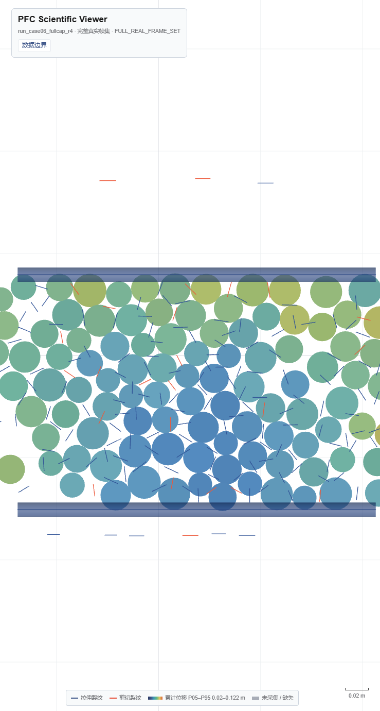
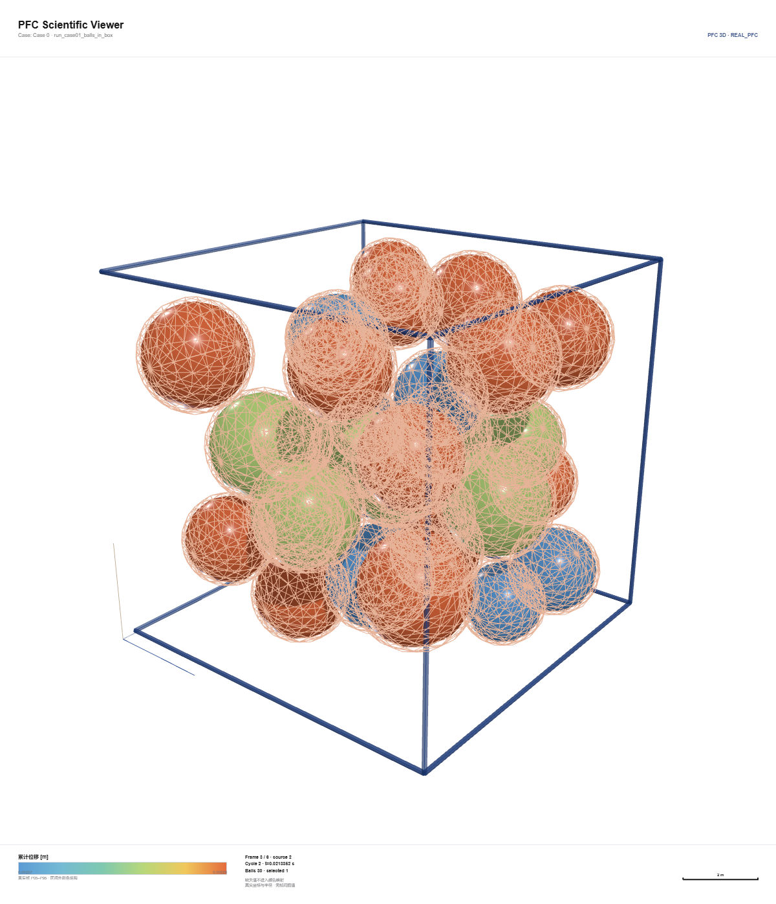

# PFC Scientific Visualization

Offline scientific Viewer and analysis for real PFC2D/PFC3D data (light theme,
local assets, no raw-data copying):

| PFC2D — dynamic cracks | PFC3D — real wall facets |
|---|---|
|  |  |

Both images are canvas-only exports from real standardized Runs processed by
this Skill (`run_case06_fullcap_r4` and `run_case06_3dfacet_r2`). Not mock
renders.

An installable scientific post-processing Skill for verified PFC2D/PFC3D
standardized data. It consumes the immutable
`pfc.standardized-experiment@1.0.0` contract produced by `pfc-headless` and
creates:

- derived physical quantities and statistics with formula lineage;
- unit-aware analysis and display formatting;
- explainable, data-driven chart selection;
- an offline Three.js/ECharts Viewer;
- adaptive publication-figure planning and vector composition;
- explicit 2D/3D linkage decisions;
- a status-honest analysis result package.

This Skill does not run PFC, access the Console bridge, capture raw files,
perform raw quality checks or standardize captured files.

## Quick start

1. Obtain a validated standardized experiment from `pfc-headless`. It must
   contain `delivery_manifest.json`, `experiment.json` and per-Case
   `arrays.npz`.
2. Analyze, select charts and build the Viewer:

   ```powershell
   & "<python>" "<skill>\scripts\run_pipeline.py" `
     --input "<StandardizedExperiment>" `
     --output "<AnalysisResult>" `
     --max-frames 0
   ```

3. Open `04_viewer/scientific_viewer.html` together with its adjacent
   `viewer/` and `data/` directories.
4. Review `03_analysis/chart_decisions.json`,
   `03_analysis/data_layers.json`, `07_metadata/source_contract.json`,
   `07_metadata/output_contract.json` and `report/experiment_report.md`.

See [SKILL.md](SKILL.md) and
[references/standardized-input.md](references/standardized-input.md).

## Responsibility boundary

`pfc-headless` owns PFC execution, real capture, raw preservation, integrity
checks, metadata management and standardized delivery.

This Skill owns scientific derivations, statistics, analytical conversions,
chart selection, rendering and publication output.

The standardized input is always read-only. Analysis output must use a separate
directory and never contains duplicate `01_raw_data/` or
`02_standardized_data/` trees.

## Data and visual boundaries

Missing values are never replaced by zeros, synthesized frames or plausible
geometry. Every channel carries `REAL_PFC`, `DERIVED`, `CONFIG`,
`NOT_CAPTURED` or `INVALID`. Generated files can still be `NOT_VERIFIED`.

The Viewer uses one shared state for Case, real frame, Cycle, time, Ball
selection, metric and range. PFC2D uses planar `CircleGeometry`, PFC3D uses
level-of-detail `SphereGeometry`, and all particles use a reused `InstancedMesh`.

The Viewer is **light-only**: the dark theme, the theme toggle and `?theme=dark`
were removed. All colors are centralized in
`assets/styles/scientific-visual-semantics.json` under `themes.light`. The
scene uses ACES tone mapping with quantitative instance colors opted out of
tone mapping, a physical-material particle preset, rim light and a local
equirectangular environment map. The default Nature ramp is the 2026-11-25
validated six-stop sequential palette (`#24486E → #366F9E → #4A9BB0 →
#7FBFA0 → #C4D97E → #F2E06B`), verified strictly monotonic in WCAG relative
luminance, sRGB grayscale and all three Machado CVD simulations; data colors
are never brightness-jittered. A high-contrast viridis ramp is selectable in
the bottom control dock but is not the default. All Three.js controls live in
a collapsed-by-default bottom dock, and the right rail contains charts only.
The render:chart split is the golden ratio (1.618:1). Export backgrounds
remain white or transparent.

The split was reaccepted on 2026-11-16 against a pfc-headless standardized
contract: the unit/contract suite reports 61 PASS and real PFC2D/PFC3D browser
regressions passed. Genuinely open items are listed in
[tests/UNVERIFIED_ITEMS.md](tests/UNVERIFIED_ITEMS.md) and the updated
[CAPABILITY_MATRIX.md](CAPABILITY_MATRIX.md): hardware performance is still
unmeasured, real endpoint-array network rendering and clump membership have no
captured evidence, and PDF output needs a local vector converter. The
[IMPLEMENTATION_REPORT.md](IMPLEMENTATION_REPORT.md) describes the earlier
integrated build and is not the current acceptance record.

## Observability, packaging and feedback verification (2026-11-24)

All additions are opt-in or additive; standardized inputs and analysis outputs
are unchanged. See `reports/UPGRADE_V0_V3_2026-11-24.md` for the full record.

- `run_pipeline.py --measure [--warm]` writes
  `07_metadata/stage_timings.json`: 7 stage durations, RSS (ctypes/psapi,
  no new dependency), tracemalloc, and input/output bytes. The report is itself
  included in `output_index.json` hashes.
- `performance_baseline.py freeze|check` records environment-tagged baselines
  and detects regressions (+20% warning, +50% failure, RSS budget, input hash).
- `package_experiment.py --package scientific|display` builds a hash-verified
  package in a temp file and publishes atomically. `display` contains only
  `04_viewer` and `05_charts`, no raw or standardized scientific data.
- `verify_feedback_loop.py` proves findings → headless ingest/approve/
  prepare-run on an isolated project copy: new Run differs from source Run and
  the source Run files remain byte-identical.
- Cleanup refuses directories whose files are claimed by `output_index.json`.

RSS and tracemalloc measure different scopes; they are reported side by side and
must not be added together.

## Standalone Viewer delivery (2026-11-25)

For offline sharing, package the whole generated viewer directory — the HTML
must stay next to `viewer/` and `data/` because vendor scripts and frame data
are loaded as relative files:

```
python scripts/viewer/package_viewer.py <viewer_root> <out.zip>
```

The ZIP preserves relative paths and is fully offline after extraction. A
2026-11-25 check on the 6,379-particle `case_17` viewer produced 151 files,
14.87 MB uncompressed → 7.95 MB ZIP (53.5%), `testzip()` clean, and headless
browser network interception confirmed 13 local `file://` requests, **zero
external requests and zero failures**, with all 6,379 grains rendered. The
`http://` strings inside vendored `three.min.js`/`echarts.min.js` are library
comments, not runtime requests.

Keep three delivery concepts distinct: **offline runnable** (no CDN/network),
**independently shareable** (ZIP + README opens on a clean machine), and
**publicly deployable** (static-site link). Only the first two were verified in
the development environment; a genuinely independent machine and static hosting
remain `NOT_VERIFIED`. ZIP compression size is not runtime memory: the runtime
also allocates decoded arrays, JSON objects, Float32Array buffers, GPU buffers,
frame caches and chart copies. Record file/download/extracted size, JS heap,
GPU estimate and peak memory separately.

## Contributing and release

- [CONTRIBUTING.md](CONTRIBUTING.md) — development and scientific-integrity rules
- [CODE_OF_CONDUCT.md](CODE_OF_CONDUCT.md) — community standards
- [SECURITY.md](SECURITY.md) — private vulnerability reporting
- [docs/VERSIONING.md](docs/VERSIONING.md) — tags and release process
- [docs/RELEASE_NOTES_DRAFT.md](docs/RELEASE_NOTES_DRAFT.md) — draft, not published
- [docs/OPEN_SOURCE_READINESS.md](docs/OPEN_SOURCE_READINESS.md) — three-Skill alignment
- [LICENSE](LICENSE) — MIT
